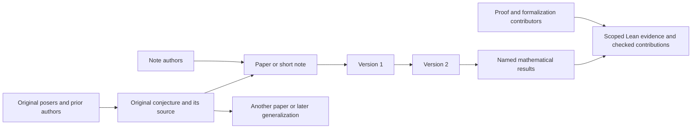

# Problems, notes, versions and formal contributions

A problem is a lasting research entry. A paper or short note explains a result
about one or more problems. Its manuscript versions are revisions of that work,
not new problems. An independent later paper is another work attached to the
same problem. Mathematical resolution, publication acceptance and Lean
verification remain separate facts.



## Identity and public display

The existing delivery `origin.problem_ids` establishes the associations. The
problem library consumes them directly; an old producer does not need a new
publication package. A stable problem key derives from the submitting identity,
producer and original problem ID, independently of work ID and manuscript
version. Multiple work IDs from that source can therefore share a problem;
multiple problem IDs can share a work. A producer name is caller supplied, so it
does not authorize merging another account's records. Titles, similar statements
and matching personal names never merge identities. Cross-source identity
reconciliation requires separate evidence.

`GET /api/v1/research-problems` lists stable problem summaries with ordinary
`limit`/`before` paging. `GET /api/v1/research-problems/{id}` returns a problem,
its original source descriptions and accepted public notes. Note pages contain
at most 25 records; pass the returned `next_before` as `before`. List queries
retain summaries, rather than copying every proof and evidence bundle. Detail
queries retain only the selected problem's note page and up to 25 distinct
source descriptions. `summary.notes` counts all currently public associated works.
Problem-list cursor order is stable identity order, not a mathematical ranking.

The contributor CLI exposes `research-problems [cursor]` and
`research-problem <id> [cursor]`; MCP provides the same read services.

The web entry is **Conjectures → Research record**, with `/problems/{id}` for a
lasting problem page. Accepted paper pages link back through `problems` in their
public response. **Open questions**, **Proved in Lean**, and **Disproved in Lean**
retain the existing independently checked target/attempt directory. A problem
entry does not create a target, a verified proof, an award or a leaderboard score.

Private drafts, private reviews, refused manuscripts and private accepted
details never create public problem entries. A visibility change also removes
that work's problem description, source evidence and contribution history. A
problem with no remaining public accepted work returns 404.

## Optional source descriptions

An adapter may map existing scientific metadata into `origin.problems`. It is
optional, omitted when empty and bound to the same delivery version as the
source. This preserves exact legacy delivery retry digests. Every description
must name an ID already in `problem_ids`; a resolution must name a statement
actually extracted from that manuscript.

```json
{
  "id": "original-problem-id",
  "problem": {
    "name": "The original named conjecture",
    "source": {"kind": "oeis", "locator": "A123456"}
  },
  "statement": "The original mathematical question, with its hypotheses.",
  "proposed_by": [{"name": "Original Poser"}],
  "resolutions": [{"claim_label": "thm:main", "outcome": "proved"}]
}
```

The example is illustrative. Map only supplied source facts. If descriptive
metadata is absent, a single problem ID with one consistent, exactly named problem
among confirmed main results may use that name as its title. Multiple IDs or conflicting
references retain the actual IDs. This title fallback invents no original statement,
poser, settlement or verification; explicit source descriptions take precedence. Existing
`origin.contributions` continues to preserve problem, mathematical-proof,
exposition, formalization and correction credit with exact source identities.
The note's author list and the original posers are separate attributions.

## What establishes a resolution

Accepted related research starts at **Reviewed research**. An author's supplied
outcome does not settle a problem on its own. The result must be a confirmed
main proved statement, its `settles` reference must equal the described original
problem, and the current accepted source audit must assess it as correct with
the existing supported source-based settlement evidence. Only then can the
problem show **Settled** or **Partial progress**. Contradictory reported full
outcomes remain visible as **Conflicting conclusions**. The typed proof or
refutation direction is source declared; it is not a new kernel receipt.

External `.lean` links retain their source revision and actual scope. They link
to existing evidence. A Mathesis verification badge and proof-use edge still
require the existing independent verifier path. Bibliographic citations,
problem associations and contribution-history predecessors do not become
checked proof-dependency edges.

## Version changes

The original acceptance record stays immutable. Applying acceptance to a new
version stores a separate snapshot of the newly accepted inputs on the
submission. Public problem, paper, receipt and download projections use the
latest applied acceptance. A new draft keeps the preceding accepted snapshot
visible; recompilation, mutable status, pending review, and a rejected revision
cannot replace it. Old source/PDF versions remain in the paper's version history.
Proofs stay bound to their own version and statement revision.

Receiving a source, confirming its extraction, reviewing it and accepting public
display are distinct stages. This relationship layer does not submit upstream
packages, invent confirmations or publish old private test manuscripts.

## Source identity during review

New manuscript review contract 4 supplies the saved delivery origin as untrusted
context to the initial reading and independent source audit. A note, its earlier
preprint and its formalized source can be artifacts of the same contribution.
Reviewers must inspect attribution, version history and scope before making that
judgment. A URL match alone does not establish it. Independent earlier mathematics
still counts as prior work; the current work's own theorem must not replace its
actual prerequisites when assessing the underlying argument. Unknown provenance
or prior status remains insufficient evidence. No source is automatically accepted,
removed from query receipts or awarded a Mathesis verification badge. Existing
rounds retain their admitted inputs; this context applies to new review rounds.
