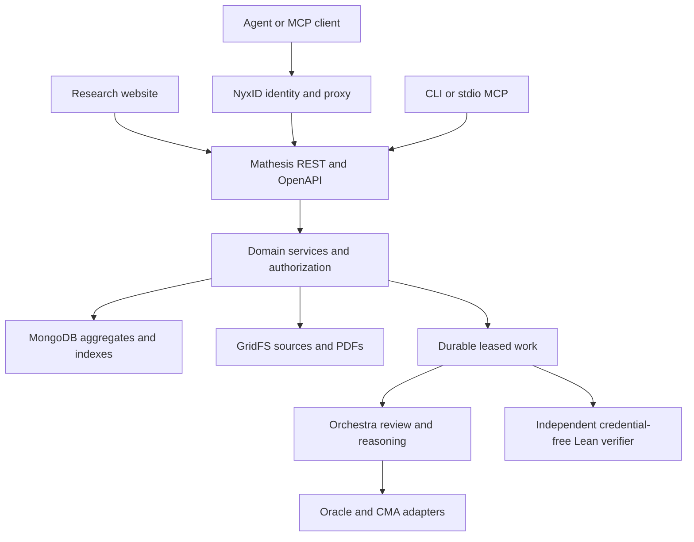

# Research services architecture

Mathesis brings people and AI together to review mathematics and develop a shared
knowledge base grounded in Lean. Papers, short notes and written conjectures enter
through mathematical review, including comparison with existing knowledge and
analysis of new mathematical information. Accepted text identifies
worthwhile formalization targets. Checked propositions and proof dependencies
provide reusable foundations for further research. Mathematical authors, prior
sources and formalizers retain their distinct attribution.

The four main participation paths are submitting a paper/note, proposing a
conjecture, working on an open problem, and contributing a formalization.
Corrections and evidence-supported source relationships remain available in the
context of the relevant result. Browser, CLI and agent access are channels to
these same services.

The current invitation programme uses service-provided model access. A NyxID
sign-in establishes identity; it does not by itself attach a personal model
subscription. Optional personal CMA access and hosted quota support retain their
existing deployment flags. BYOK funding is distinct from providing a machine.
The site only offers quota support when its deployment enables it.

## Architecture and responsibility

The implementation follows CMA's interface/domain/adapter separation and
NyxID's identity and service-connection model. The inspected references are
CMA's `CLAUDE.md`, NyxID's `docs/quickstarts/mcp-wrapping.md`,
`docs/MCP_DELEGATION_FLOW.md`, CLI proxy reference and OpenAPI parser. No upstream
CMA or NyxID changes are required by this change. Reference revisions:
[CMA 1c71725](https://github.com/ChronoAIProject/cma/blob/1c717253d82eb4fbeecbb1eae3738d0734bceaef/CLAUDE.md)
and [NyxID 84916e2](https://github.com/ChronoAIProject/NyxID/blob/84916e2d2fccbd1aacffe0614fe02d24329cbaf1/docs/MCP_DELEGATION_FLOW.md).



MongoDB was already Mathesis's authoritative store. This work extends it with
archive indexes and a `lean_deposits` collection; it does not introduce a
parallel database, identity provider or proof-acceptance mechanism.

| Service | Current implementation | Durable evidence |
|---|---|---|
| Paper discovery | Indexed search of Mathesis publication metadata, author/MSC/type filters, cursor pages | Immutable accepted record and publication snapshot; live visibility checked again |
| Review | Private review or publication review; evidence, author responses and durable rechecks; readable and JSON reports | Source digest, paper version, claims revision, append-only rounds and delivered letters |
| Lean intake | Standalone source deposit with original authors, mathematical statement, source reference, toolchain and license | Immutable GridFS source/digest and attributed deposit; exact replays return the same id |
| Lean verification | Owner links a deposit to an existing confirmed public target | Ordinary durable attempt and independent verifier receipt; CAS-fenced attempt links |
| Machine access | REST, OpenAPI, expanded stdio MCP and CLI; optional NyxID CLI transport | Same authenticated domain operations as the website |

## Discovery semantics

`GET /api/v1/papers?q=prime&author=Smith&msc=11&kind=paper` searches the full
archive, not the currently displayed page. `q` is plain words; matching any
word selects a candidate. It searches title, author names, accepted abstract
and DOI. An exact `WP-…` query selects that record. Author matching is a literal,
case-insensitive substring of one author's name, as stored or in the canonical
`Given Family` form, so `Ma, Haobo` and `Haobo Ma` select the same works (see
[ACADEMIC_ARCHIVE.md](ACADEMIC_ARCHIVE.md)). MongoDB preselects candidates by
the query's literal terms, with regex metacharacters escaped, and the Layer 2
rule decides each match, as in the memory adapter. MSC is a
classification prefix. Results use descending record ids and `next_before`.
Keep the same filters when following a cursor.

MongoDB uses `archive_text_v1` with language `none`, so it does not stem words
or discard English stop words. Separate kind/id and publication-MSC/id indexes
support filtered browsing. The search aggregate joins the indexed submission
id to its live public/private visibility before limiting a page, with a
10-second database deadline. Layer 2 rechecks visibility on projection. Hidden
candidates do not produce extra pages or cursors. Queries are bounded and
cannot inject Mongo operators. The dev memory adapter implements plain-word
matching; it is not a production search engine.

Unfiltered listing retains the existing metadata-only private-record contract.
Filtered search returns public items only. New private revisions never replace
accepted search inputs. Legacy records without a publication snapshot have
only their immutable title and author fields indexed; abstract/MSC coverage
requires a separately validated historical-publication backfill. Search does
not yet federate arXiv, Crossref or OpenAlex, search PDF bodies, or provide
semantic/vector ranking.

## Review reports

`GET /api/v1/submissions/{id}/review` downloads `mathesis-review.json` with
`schema_version: 2`, `service: "Orchestra"`, current source SHA-256, paper
version, claims revision, submission status, claims, review rounds and letters.
Each historical round retains its own version and claims revision; consumers
must not interpret an old round as a review of the current source.

Both authors and staff get the existing **author-safe** projection from this
export. Advice, letter drafts, provider task identifiers, raw model prompts,
credentials and private probe files are excluded. Private reports never enter
the public search index. Reports use `Cache-Control: private, no-store`.
Review findings are judgements; they never confer a Lean verification badge.
Publication policy is unchanged. Independent private review is available through
`purpose: "review_only"` at the ordinary submission endpoint and `/submit?type=review`.
It forces private visibility and disables volunteer access. Auditing sets
`review_complete`; advice and the letter follow, without record creation or an
accepted-only Lean probe. `review_scope` optionally names the author's focus.

`GET /submissions/{id}/review.md` downloads the readable report. Concerns include
reported location, basis and complete retained evidence, including offline arguments.
Historical source hashes remain attached to the corresponding rounds.
`POST /submissions/{id}/review/responses` appends an author/co-author response with
`round`, zero-based `concern`, current `version`, `claims_revision`, and `body`
(1–10,000 characters). The immutable response requests an ordinary durable recheck;
no finding is automatically resolved. Exact requests replay idempotently. Admission
is limited to five responses per paper per 24 hours, 200 in total. Upload and confirm
source revisions first. Reconciliation recovers saved responses if enqueue fails.

## Lean intake and verification

`POST /api/v1/formalizations` takes JSON with `title`, `authors`, `statement`,
`source_reference`, `toolchain`, `license` and `solution`. A source is a UTF-8
Lean module of at most 1 MiB. A repository permalink at a fixed revision is
recommended for attribution; a URL is a reported source, not an independently
verified provenance claim. The uploader's identity and original authors are
stored separately. The deposit is private to its owner and staff.

The complete validated request and authenticated owner determine a stable
content id. Exact retries return the existing deposit. Metadata is immutable;
changed source/metadata yields a new deposit. The source lives in GridFS.
`GET /formalizations` lists the owner's deposits; `GET /formalizations/{id}`
returns metadata and linked attempts; `/source` downloads the original module.
Deposit listing uses stable descending content ids, not submission-date order.

`POST /formalizations/{id}/attempts` with `{record, claim}` is an explicit
verification request. Only the deposit owner can request it. The stored
`toolchain` must exactly match the confirmed target. The source enters the
existing target → attempt → independent verifier path, with all its quotas,
idempotency, current-input checks, receipts and public-proof rules. Attempt ids
are appended to the deposit using revision fences. A retry after a crash between
attempt admission and link persistence finds the same attempt and repairs the
link. The attempt reconciler recovers admitted verification work.

A deposit is **received**, not verified. A verified attempt becomes public only
while its source and exact confirmed target remain current and public. A
standalone deposit does not create a paper, target or approval.

### Multi-file formalizations and provenance

Optional `modules` maps dotted module names (e.g. `Research.Helpers`) to complete Lean
source. Up to 512 supporting modules are accepted; adapter plus supporting sources
must total at most 8 MiB. Inert project configuration is preserved in `project_files`. Each file is stored in GridFS with its digest. Optional
`formalizers` separates Lean contributors from original research authors;
`source_revision` records a full 40/64-digit Git commit. A reported repository
or commit is provenance supplied by the uploader, not a fetched/authenticated
repository snapshot. `GET /formalizations/{id}/project` downloads all sources
and attribution as reusable JSON; it is owner/staff-only and no-store.

The independent verifier checks every supporting source, rejects cycles,
traversing/reserved/case-colliding module names and trusted-library shadowing,
and builds modules in dependency order between Target and Solution. It checks
the final theorem's type and axiom closure in a separate Check module. The
same conservative forbidden-construct rules apply to every file, including
unused modules. Receipt `solution_digest` is SHA-256 of the UTF-8 source for
legacy single files; with modules it hashes the compact JSON tuple
`["mathesis-project-v1", solution, modules]` with module keys sorted. Replay,
quotas, leased jobs, current-input checks and credit all use that bound digest.

Supported imports are prepared Mathlib modules, Target and submitted modules, including nested module paths, and
modules of prepared libraries that the verifier workspace declares (none by default; see
[LIBRARY_BINDING.md](LIBRARY_BINDING.md)). This is
a bounded source-project format, not execution of arbitrary Lake projects:
custom packages, user build scripts, network installs and
unsupported Lean metaprogramming are not run. Dependencies come from the trusted
pinned Lean/Mathlib workspace. Only a verifier receipt confers Lean ✓.

The verify request accepts `expected_target` (SHA-256). The target-aware web
flow supplies it and refuses a changed target. Original authors, formalizers,
source revision and license remain immutable on the attempt and appear publicly
with verified proofs. Submitting identity and leaderboard credit remain separate
from reported authorship; authorship is not independently authenticated.

### Formalization participation directory

`GET /formalizations/opportunities?q=&kind=&status=&limit=&before=` is public.
It returns current author-confirmed targets for paper results and conjectures,
with status `open`, `verified` or `disproved`, toolchain/digest, public verified
counts and winner attribution/receipt. It never exposes queued/rejected private
attempts or standalone private deposits. Search matches all case-insensitive
words across record, title, statement label, statement and author names.

Mongo uses the `solve_files` admitted/id index and cursor batches. Domain
projection rechecks live visibility, admission, current version, claim revision
and target confirmation before filtering and pagination. It stops after one
extra matching result, rather than materializing all records in memory. Very
selective queries can still scan multiple batches; this is not full-text or
semantic search. Cursors use descending solve-file ids, not submission dates.

The website exposes this directory in primary navigation. A contribution link
opens the Lean form with statement, research authors, source link, pinned
toolchain and target digest already selected. Users explicitly submit for
verification; unlinked deposits remain private. Existing rejected/queued
attempts and new attempts can be inspected from the depositor's workspace.

## NyxID connection

The machine-readable research-service contract is
`GET /api/v1/openapi.json`. Paths contain the complete `/api/v1` prefix so
NyxID's parser resolves them against the **venue origin**. This spec covers the
research-service operations listed in it, not every staff/admin operation.

An operator connects the venue origin in NyxID, associates this OpenAPI URL,
and enables the existing caller access-token forwarding mode. Mathesis verifies
NyxID access tokens using its existing JWKS/audience rules and evaluates the
caller in Layer 2. Never register a shared owner's personal token as a general
multi-user credential: that would collapse callers into one person. Plain
identity headers are not accepted as authentication.

NyxID only forwards an actual request bearer in this mode. API-key-only and
session-only MCP calls do not synthesize a bearer; such deployments need their
existing supported delegation integration before private Mathesis operations
can work. This change does not silently trust injected headers or provision
new upstream access. A spec being discoverable is not proof of authentication
working: validate identity with `/api/v1/me` before using private resources.

For a connected service, use the installed and signed-in NyxID CLI:

```sh
nyxid proxy discover
nyxid proxy request mathesis api/v1/me
export WISHPOOL_NYXID_SERVICE=mathesis
mathesis-contribute papers 'prime gaps'
mathesis-contribute review <submission-id>
claude mcp add mathesis -e WISHPOOL_NYXID_SERVICE=mathesis -- mathesis-contribute mcp
```

The SDK invokes NyxID directly without a shell; JSON bodies use stdin and no
bearer is passed on the command line. A nonzero proxy exit fails the tool; no
private response is fabricated. Direct mode remains available with
`WISHPOOL_URL` and optional `WISHPOOL_TOKEN`; anonymous access works for public
research discovery. Production service registration and live NyxID MCP
identity forwarding are separate operational checks, not completed by a local
unit test.

## Further foundation work

The next substantial capabilities are federated literature discovery with
source-specific attribution and cached fetch timestamps; historical archive
backfill; general Lake-project import with pinned custom dependencies; and
an author-facing research job that adapts deposited proofs to confirmed targets.
The existing review pipeline supplies literature analysis, but it is not a
standalone bibliographic index. Publication still follows admission; separating
archive deposit from review acceptance is a distinct policy/data-model change.

## Verification bundles

`GET /api/v1/papers/{record}/statements/{claim}/attempts/{attempt}/bundle`
downloads JSON schema 1 for a currently public, verifier-passed attempt. It contains
the source digest/version and claim revision, public attribution and original
receipt, and a `verification_request` with the exact Target, Solution, supporting
modules and pinned toolchain. Private or stale targets and queued/rejected attempts
are unavailable. Responses are `no-store`.

Extract `.verification_request` and pass it on stdin to `mathesis-verifier` with
`WISHPOOL_LEAN_WORKSPACE` set to a prepared matching Lean/Mathlib workspace. A new
check creates a new receipt; the historical checker binary revision was not recorded.
This is a portable evidence package, not a dependency installer or permission to
execute user Lake scripts. Independent external theorem admission still needs a
separate target provenance/semantic-confirmation path; a private deposit alone
never creates a public verified theorem.

Complete project preflight, independent adapters, manuscript evidence manifests and
review coverage limits are specified in [project and evidence intake](PROJECT_AND_EVIDENCE_INTAKE.md).

## Lean knowledge and public research connections

The knowledge graph page opens with public author-confirmed Lean targets,
independently checked intermediate propositions and actual proof-use connections.
It projects the existing Rust public formalization-directory,
checked-contribution and result-use services, in pages of eight targets. A failed
neighborhood request produces a retryable error rather than an invented empty
relationship. A source conjecture can remain open while one of its intermediate
propositions is checked and reused elsewhere. Only the exact used proposition
receives the dependency arrow; the surrounding source problem is not declared
proved or independently sufficient.

The separate “Papers and sources” view preserves the existing citation graph and
its source credit. Citations do not become formal dependencies. Original query,
focus and cursor links continue opening their citation view.

The operator-admitted Trureturing source index already informs review. It is not
yet a public declaration browser on this page: this view projects Mathesis's own
current public targets and proof receipts. Existing upstream Lean evidence keeps
its source identity and attribution; linking it does not manufacture a Mathesis
verification receipt.

## Importing a link to Lean code

The web form can import a public GitHub `.lean` file using its permanent URL at a
full 40- or 64-character Git revision. Blob and raw URLs resolve to the same
canonical source reference. The browser reads at most 1 MiB, with a 30-second
request deadline, no credentials or referrer, and no redirects. It rejects branch
links, non-GitHub locations, HTML, empty files and invalid UTF-8. Source bytes,
revision, declared mathematical authors, formalizers and license then enter the
ordinary attributed deposit API. No GitHub identity is inferred to be an author.

Multi-file work uses the existing complete-project upload. A linked single file keeps its repository-relative module path. A root
`Solution.lean` is an adapter; other files remain supporting modules, so attaching
a Solution adapter preserves the original source for verification. Source reception does
not imply verification: public target linking, preflight and the independent
verifier retain their current requirements. Deposits without a public confirmed
target remain private sources.
